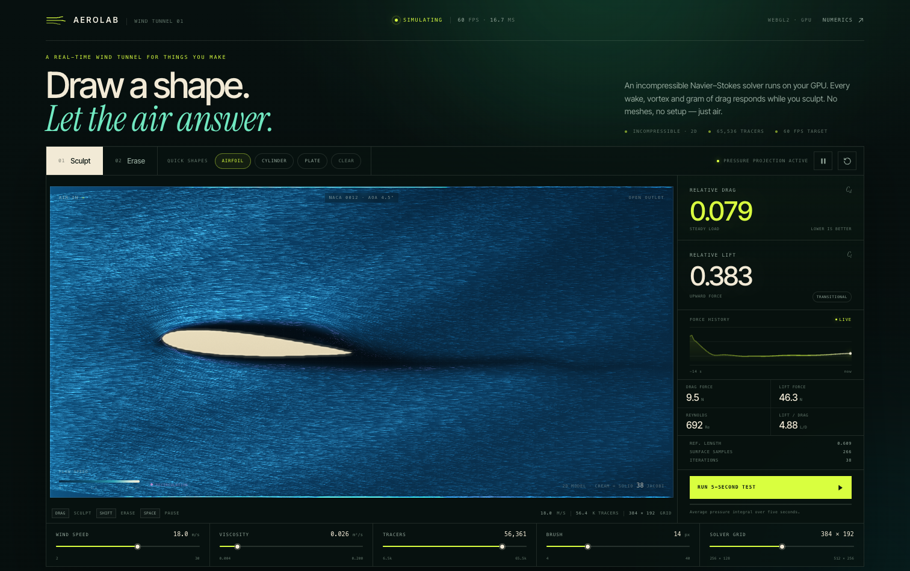

# AEROLAB

A real-time, browser-based wind tunnel in 2D and 3D. Draw a silhouette (or hold
an object up to your webcam), and watch a GPU Navier–Stokes solver — or a 3D
lattice-Boltzmann solver — reveal the wake, vortices and pressure loads. No
meshes, no server, no simulation dependencies.

AEROLAB now includes everything from the earlier Slipstream prototype: camera
shape capture, vorticity view, Card/Car presets, the 5-second test, a local
leaderboard and the flow coach.



## Run

```bash
npm install
npm run dev -- --port 5190
```

Open <http://localhost:5190>. Production build:

```bash
npm run build
npm run preview
```

## Controls

| Input | Action |
| --- | --- |
| Drag on the test section | Sculpt solid geometry |
| `Shift` + drag / right-drag | Erase |
| `Space` | Pause / resume |
| Quick shape pills | Airfoil, cylinder, plate, card, car |
| 2D / 3D | Switch between the GPU 2D solver and the D3Q19 3D solver (drag to orbit, scroll to zoom, double-click to reset) |
| Wing / Extrude / Revolve | How the 2D silhouette is lifted into 3D |
| Camera tab | Webcam colour-key silhouette with smoothing, hole fill and quality diagnostics; freeze before testing |
| Vorticity | Red/blue signed vorticity overlay (2D) |
| Bottom sliders | Wind speed, viscosity, tracer density, brush radius, solver grid |
| Run 5-second test | Time-average `Cd` and `Cl` from the live force signal |

## Architecture

```
src/
  sim3d.js         D3Q19 BGK lattice-Boltzmann solver + orbit-camera renderer
  camera.js        Webcam silhouette tracker
  leaderboard.js   Efficiency score, localStorage board, flow coach
  gl/
    utils.js       WebGL2 context, programs, FBOs, fullscreen quad
    shaders.js     GLSL ES 3.00 solver, background and particle shaders
    fluid.js       fractional-step solver orchestration
    mask.js        obstacle canvas + RGBA8 mask texture
    particles.js   65,536-tracer GPGPU update and streak renderer
    renderer.js    background + particle composite
  telemetry.js     async pressure readback and boundary force integral
  state.js         store, defaults, slider mappings
  ui.js            DOM bindings, chart, benchmark state
  main.js          bootstrap, frame loop, benchmark timer
```

### Field layout

The physical test section is **2 × 1** (a wide 2:1 domain). `size` is the
vertical grid resolution, so a `192` setting allocates `384 × 192` float
textures.

| Field | Format | Purpose |
| --- | --- | --- |
| velocity | RGBA16F, ping-pong | `(u, v, 0, 1)` in physical units / s |
| pressure | RGBA32F, ping-pong | Jacobi pressure solve + async readback |
| divergence | RGBA16F | `∇·u` |
| obstacle | RGBA8 | solid mask uploaded from a 2D canvas |
| particles | RGBA32F ×2 | `(x, y, speed, life)` in UV space |

`uCell = 1 / size` is the physical cell size on both axes.
`uInvDomain = (size / width, size / height) = (0.5, 1.0)` converts physical
velocity into UV displacement.

### Fractional-step solver

Each frame, in order:

1. **Semi-Lagrangian advection** — trace each cell backwards through the
   velocity field, sample, and apply dissipation/viscosity.
2. **Divergence** — central differences over the physical cell size.
3. **Jacobi pressure** — 32–44 iterations of
   `p = (pₗ + pᵣ + p_b + p_t − ∇·u · Δx²) / 4`, with Neumann pressure at solids.
4. **Projection** — `u ← u − ∇p`, free-slip tunnel walls, inlet shear and solid
   no-slip constraints.

A small time-varying inlet shear seeds the Kelvin–Helmholtz instability, so a
nominally symmetric body still sheds a visible vortex street.

### Pressure telemetry

Pressure is copied into a pixel-pack buffer with a fence, so the CPU never
blocks the GPU every frame. When the fence resolves, the CPU walks the
solid/fluid interface and integrates

```
F = ∮ −p n ds          Cd = Fd / (½ ρ U² L)      Cl = Fl / (½ ρ U² L)
```

The reference length `L` is the body's bounding-box extent in physical units.
Metrics update at roughly 20 Hz while rendering continues at 60 FPS.

### Particles

A 256 × 256 RGBA32F texture stores 65,536 tracers. A fragment pass advances each
with midpoint RK2, respawns runaways at the inlet, and the render pass expands
each tracer into a velocity-oriented streak. Color maps normalized speed from
deep blue → cyan → cream, with muted violet in recirculation.

## Verification scripts

Puppeteer scripts live in `scripts/`. They expect the dev server on port 5190:

```bash
node scripts/check.mjs        # full smoke test + screenshots
node scripts/smoke.mjs        # interaction test
node scripts/cylinder-long.mjs # 20 s wake observation
```

The headless Chrome executable path is configured for macOS in each script.

## Notes

- WebGL2 is required, including `EXT_color_buffer_float`.
- The solver deliberately uses a coarse grid for interactive 60 FPS. The
  telemetry is a relative comparison tool, not a validated CFD result.
- Tailwind v4 is loaded through `@tailwindcss/vite`; the editorial UI itself is
  hand-written CSS in `src/style.css`.
